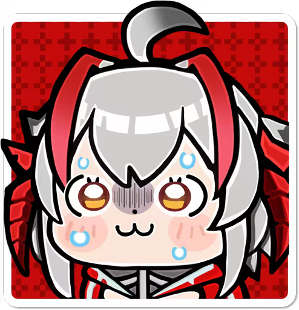

# NO.1 Vivimei Pet Personal Work Table

作者述：首先谢谢你看到我的作品，作为一个目前不会代码的小白，这是我第一个接触使用agent（前期workbuddy，中后期codex+deepseek）做出来的作品，主要是给自己用作经验积累和作品集以及日常生活陪伴用的！其实做的不是很完美，但是总要有个不完美的开头才能让后面做新作品更有动力吧！
这是一个面向 macOS 的桌面智能宠物与个人工作台，使用 Python、PyQt6 和 Qt WebEngine 构建。（之后再看会不会做win版的）然后由于本人也特别喜欢动森美学，所以工作台自己手搓前端排版设计了！但是我的agent好像不太听话，做出来的效果不是特别好（泪）只能尽可能做成现在的样子了。部分交互也不是很满意，不过先做一版！



## 功能

- 桌面AI宠物自主活动、点击互动、拖动、落地与用户可操控活动（wasd按键，电脑底部+左右屏幕侧边可吸附）。
- 7 种心情情绪记录与每日/周/月情绪统计（左键长按桌宠3秒以上后并使用鼠标滚轮即可出现）。
- 待办清单、想法速记、公告栏与桌宠啥子聊天室与复盘总结的一体化工作台（双击桌宠即可打开）。
- 可配置API兼容接口的桌宠聊天与复盘总结。
- ddl提醒、免打扰和个人工作台数据均保存在本地。
- 对女性用户可自主记录月经第一天的标志来告诉自己月经时间（防忘）。
- 右键单击设置可自定义桌宠大小、开启与否键盘操控、开启与否自由行动、性别、跌落设置与API余额详情。
- PS：其实工作台的界面大小调成屏幕的1/4or1/3的话会比较好看齁（我自己就是差不多这个大小来看我的内容的）
  
## 环境要求

- macOS 13 或更高版本
- Python 3.12
- 依赖见 `requirements.txt`

## 安装与启动

```bash
python3.12 -m venv .venv
source .venv/bin/activate
python -m pip install -r requirements.txt
python -B -u main.py
```

macOS 也可以先双击 `安装依赖.app`，再双击 `启动桌宠.app`。

## API 配置

API 配置位于实际使用的 `vivimei/oc.py`。使用前请填入自己的 API Key、接口地址和模型名：

```python
DEEPSEEK_API_KEY = "你的 API Key"
DEEPSEEK_BASE_URL = "你的 API 接口地址"
DEEPSEEK_MODEL = "你的模型名称"
```

聊天内容会在调用 API 时发送到你配置的服务。没有配置 API 时，不应当把任何密钥提交到 Git 仓库。

## 数据与隐私

首次运行后，应用会在本地创建 `data/`，其中可能包含：

- `data/chat_history/`：聊天记录
- `data/chat_memory/`：聊天摘要
- `data/emotion_history.json`：情绪记录
- `data/workbench_data/`：待办、速记和工作台本地存储
- `data/settings.json`：桌宠设置

`data/` 已被 `.gitignore` 排除。提交或发布前请确认 API 配置和个人数据都没有进入 Git 历史。

## 项目结构

```text
main.py                 应用入口
vivimei/                桌面宠物、聊天、工作台与情绪模块
workbench/index.html    工作台前端
assets/                 动作、图片与应用图标
tests/                  打包与隐私清理测试
tools/                  清洁发布构建脚本
requirements.txt        Python 依赖
```

## 测试与构建

```bash
python -m unittest discover -s tests -v
python tools/build_clean_release.py
```

构建脚本会生成默认的清洁数据模板，并将 API Key、接口地址和模型名替换为占位符。

## 授权与致谢

非常感谢 [OTAXIO/digit_maid](https://github.com/OTAXIO/digit_maid) 项目提供的素材参考（老大做的真好真可爱太喜欢了）。同时非常感谢yanstu和254558张帅老师的（https://github.com/yanstu/animal-island-ui-vue）组件，太可爱了喜欢！在这个大开源时代里活着真的是太好了（泪）。原始角色美术和素材版权归各自权利方所有。本仓库仅用于个人、非商业的桌宠+工作台功能的使用，不是 Codex、OpenAI 或游戏官方素材发布。
